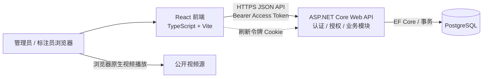
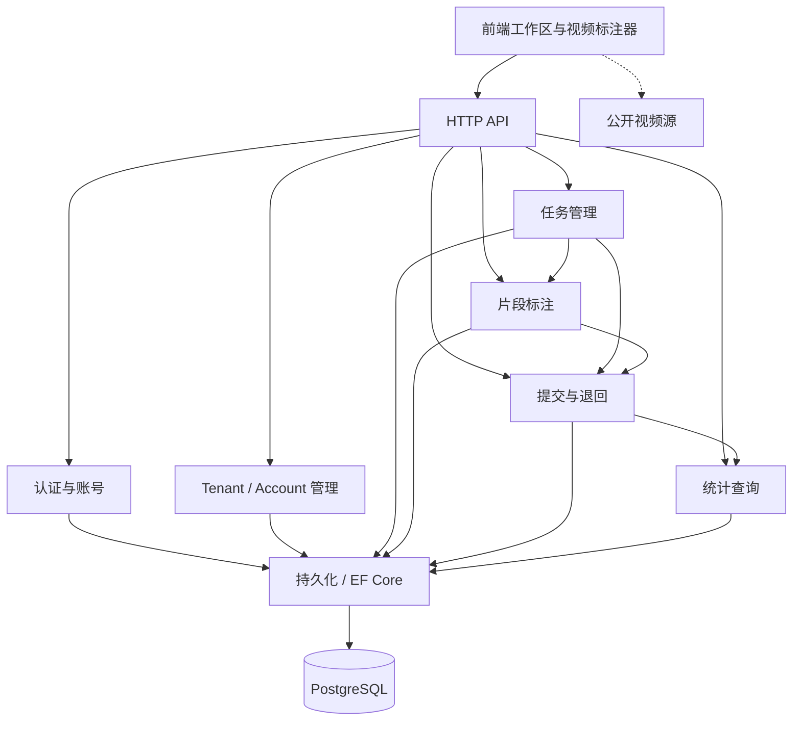

# 视频片段标注平台概要设计

> 文档定位：确定系统整体架构、主要模块及其关系，并记录正式技术栈决策，作为详细设计与实现拆分的依据。
>
> 需求依据：[proposal.md](proposal.md)。本文中标注为“已确认”的技术选型来自需求讨论；未在概要设计阶段定下的实现参数应在详细设计中明确，不视为产品需求。

## 1. 设计目标与范围

系统为机器人示教视频提供按租户隔离的任务分配、片段标注、提交和每日有效工作量统计。概要设计重点保证：

- 后端执行身份、角色和租户授权，不以界面隐藏代替隔离。
- 领取、取消、退回、保存和提交通过一致的状态转换和事务处理，满足需求中的并发规则。
- 统计以当前有效提交为准；退回时移出统计，重新提交时按新提交时间归属。
- 管理员登记可由浏览器直接播放的公开视频 URL；平台不接收或保存视频文件。
- 前后端可分别构建和部署，并通过明确的 HTTP API 协作。

本设计不规定具体页面布局、完整 API 清单、数据库逐字段定义、云服务商或生产环境规模参数，这些由详细设计及部署设计补足。

## 2. 总体架构

采用**前后端分离架构**。浏览器加载独立部署的前端静态应用；前端通过 HTTPS 调用 ASP.NET Core 后端 API。后端负责认证、授权、业务规则和数据访问，并通过 EF Core 读写 PostgreSQL。浏览器直接向公开视频源请求视频流，应用后端不代理视频流。

### 2.1 部署单元

- **前端应用**：独立构建并部署静态资源；配置后端 API 地址和允许的 API 源站。
- **后端 API**：ASP.NET Core Web API，独立部署；仅对浏览器/API 提供业务接口，不提供视频代理。
- **关系数据库**：PostgreSQL，保存租户、账号、任务、片段和刷新令牌相关数据。
- **视频源**：由任务提供的公开视频直链，不属于平台部署单元或持久化存储。

本地演示需提供数据库启动方式、数据库迁移和虚构演示账号。具体容器编排及生产部署平台不在需求中，留待部署设计决定。

## 3. 模块划分与关系

### 3.1 前端模块

| 模块 | 职责 |
| --- | --- |
| 登录与会话 | 登录、登出、访问令牌内存管理、使用刷新 Cookie 恢复会话。 |
| 管理员工作区 | 租户、账号、任务管理；每日统计及逐层明细查看；退回已提交任务。 |
| 标注员工作区 | 展示本租户可领取任务及本人任务，执行领取、退回、标注和提交。 |
| 视频标注器 | 播放视频、读取可获得的视频时长、编辑毫秒精度片段、呈现边界可校验提示。 |
| API 客户端 | 统一处理 API 请求、Bearer 头、认证过期、错误与加载状态。 |

前端负责展示和交互，不负责最终权限判断或业务有效性裁决。

### 3.2 后端模块

| 模块 | 职责 |
| --- | --- |
| 认证与账号 | 密码登录、令牌签发和刷新、账号停用检查、角色识别。 |
| 租户管理 | 平台管理员创建、查看和停用租户；保留租户历史数据。 |
| 账号管理 | 管理员创建管理员及绑定租户的标注员，停用账号。 |
| 任务管理 | 管理员创建、发布、取消任务；标注员查询、领取和退回未提交任务。 |
| 片段标注 | 对片段执行新增、编辑、删除、查询；在服务端验证顺序、重叠和可用的视频边界。 |
| 提交与退回 | 原子化提交及锁定、管理员退回、原片段保留和重新提交。 |
| 统计查询 | 按 Asia/Shanghai 提交日期查询当前有效时长，并展开到租户、人员、任务和片段。 |
| 持久化 | 通过 EF Core 访问 PostgreSQL，负责事务边界和数据库迁移。 |

后端各业务模块通过应用服务协作，持久化模块不向前端暴露。授权和领域校验在写入应用服务中执行，不能仅依赖 API 路由或前端传入的租户标识。

### 3.3 模块关系

## 4. 技术栈决策

本节是本项目技术栈的正式决策记录。

| 层次 | 决策 | 选择依据 |
| --- | --- | --- |
| 架构 | 前后端分离部署；前端与后端通过 HTTPS API 通信 | 用户已确认。前后端可分别构建和部署，API 边界清晰。 |
| 前端 | React + TypeScript + Vite | 用户已确认。组件模型适合视频标注交互，TypeScript 支持较明确的数据契约，Vite 提供轻量开发及构建流程。 |
| 后端 | ASP.NET Core Web API / C# | 用户已确认。类型约束、授权中间件和事务能力适合显式实现任务状态、角色和租户规则。 |
| 数据库 | PostgreSQL | 用户已确认。事务和并发控制适合原子领取及状态转换，支持关系型明细与统计查询。 |
| ORM / 迁移 | Entity Framework Core + PostgreSQL provider | 用户已确认。与 ASP.NET Core 集成成熟，可统一实体映射、事务和 schema migration。 |
| 认证 | JWT Bearer Access Token + Refresh Token | 用户已确认。访问令牌用于 API Bearer 认证，刷新令牌用于延续会话。 |
| 访问令牌存储 | 前端仅保存在内存 | 用户已确认。API 请求通过 Authorization Bearer 头传递；页面刷新后用刷新令牌恢复访问令牌，不持久化访问令牌。 |
| 刷新令牌存储 | HttpOnly + Secure Cookie | 用户已确认。JavaScript 不可读取；刷新 Cookie 需按部署源站配置 SameSite、CORS 凭据和 CSRF 防护。 |
| 视频访问 | 浏览器直接播放管理员登记的公开视频直链 | 用户已确认，且符合需求。平台不上传、不代理、不持久化视频，避免引入视频带宽和存储子系统。 |
| 时间存储 | UTC 时间戳；片段时间以整数毫秒保存 | 业务规则规定统计按 Asia/Shanghai 归属，但片段相对视频起点，不做时区转换。 |

未锁定的实现参数包括访问/刷新令牌有效期、刷新令牌轮换和撤销细节、Cookie 的具体 SameSite 值、生产源站白名单、具体 .NET/Node 包版本及部署平台。详细设计和部署配置应给出这些参数，不能改变上述正式选型。

## 5. 核心数据概念

此处为概要级概念模型，不替代数据库详细设计。

| 概念 | 主要信息与关系 |
| --- | --- |
| Tenant | 租户名称、启停状态。任务及标注员关联租户；停用后保留历史数据并禁止后续操作。 |
| User | 登录标识、密码哈希、角色、启停状态、可空 tenant_id。标注员必须绑定一个租户；平台管理员可不绑定租户。 |
| Task | 租户、名称、公开视频 URL、说明、截止时间、状态、领取人、最近成功提交时间。任务是片段集合的归属对象。 |
| Segment | task_id、起始毫秒、结束毫秒。只保存当前版本；任务退回时保留并允许原地修订，不要求修改历史。 |
| RefreshToken | 关联用户的刷新令牌指纹、过期时间及撤销状态；不保存可直接复用的明文令牌。 |

### 5.1 任务状态机

任务状态枚举如下：

| 状态 | 含义 |
| --- | --- |
| 可领取 | 已发布且当前没有标注员领取。 |
| 已领取 | 由一名标注员持有，尚未提交。 |
| 已提交 | 当前提交有效，片段锁定并参与统计。 |
| 待修正 | 管理员退回了最近一次提交，原片段保留，允许标注员修改。 |
| 已取消 | 管理员取消的终态，不允许领取或提交。 |

需求已明确的合法流转如下。需求未定义的转换不在本表中推定为允许或禁止，需在需求确认或详细设计中处理。

| 当前状态 | 操作与操作者 | 下一状态 | 约束 |
| --- | --- | --- | --- |
| （新任务） | 管理员发布 | 可领取 | 任务须指定租户、名称和公开视频 URL。 |
| 可领取 | 标注员领取 | 已领取 | 标注员必须属于任务租户；并发时最多一个请求成功。 |
| 可领取 | 管理员取消 | 已取消 | 取消后不可领取。 |
| 已领取 | 标注员提交 | 已提交 | 至少一个有效片段并通过全部提交校验。 |
| 已领取 | 标注员退回 | 可领取 | 清除领取关系。 |
| 已领取 | 管理员取消 | 已取消 | 与解除领取在同一原子操作完成。 |
| 已提交 | 管理员退回 | 待修正 | 保留原片段；退回期间不计入统计。 |
| 待修正 | 标注员重新提交 | 已提交 | 使用当前片段重新校验并记录新的提交时间。 |

标注员在已领取或待修正状态下保存片段属于状态内编辑，不改变任务状态；已提交和已取消为不可直接编辑的状态。逾期由截止时间派生或查询时标记，不构成独立状态，也不阻止领取或提交。领取关系与状态必须由后端状态转换共同维护。

统计可由当前状态为已提交的任务及其片段实时计算：每个任务的有效时长为其所有片段 `(end_ms - start_ms)` 的和；按最近一次成功提交时间转换到 Asia/Shanghai 后归属日期。退回任务立即不符合统计条件；重新提交后使用新的提交时间和当前片段重新计算，因此旧提交日不再计入该任务。

## 6. 关键业务流程与一致性

### 6.1 领取任务

后端在单个数据库事务中检查任务处于可领取状态、租户仍启用且请求用户属于该租户，再原子地写入领取人并转换状态。使用条件更新、行锁或等效的并发控制，确保两个并发请求至多一个成功。失败方收到明确的冲突响应并刷新任务状态。

### 6.2 保存与提交

保存片段和提交前均重新检查操作者、租户、任务状态及领取关系。提交在事务中锁定或条件更新任务，校验至少一个片段、起点小于终点、片段互不重叠，以及在可取得视频时长时的范围。相邻片段允许首尾相接。校验通过后记录提交时间并转为已提交，后续标注修改请求必须拒绝。

### 6.3 取消、退回和并发竞争

管理员取消已领取但未提交任务时，在同一原子转换中清除领取关系并设置已取消状态。管理员取消未领取任务可直接设置为已取消；已提交任务不能取消。管理员退回已提交任务时转为待修正并保留片段。标注员主动退回未提交任务时清除领取关系并恢复可领取状态。

取消/收回、保存和提交竞争时，以数据库事务中第一个成功的条件状态转换为准：取消先完成则后续保存/提交因状态不符而拒绝；提交先完成则任务已提交，只能按退回流程处理。所有写操作都须在服务端再次校验状态，不能依赖前端缓存。

### 6.4 视频时长

前端播放器在可用时读取浏览器获得的视频元数据并将时长（毫秒）用于即时提示和范围校验。不能获得视频总时长时，界面明确提示视频边界未能校验；服务端仍强制校验正长度、无重叠和至少一个片段。服务端不抓取用户输入的 URL，避免将视频代理或 URL 抓取扩展为服务端职责。

## 7. 安全与隔离

- 每个 API 请求从已验证的身份声明取得用户 ID、角色和租户 ID；标注员请求的租户范围以身份绑定为准，不信任请求体或查询参数中的租户 ID。
- 平台管理员接口单独执行角色策略；标注员接口还需核验租户状态、用户状态和资源归属。
- 账号或租户停用在登录、领取、保存、提交等相关操作中生效，历史记录不删除。
- 密码只存储经适当密码哈希算法处理的摘要，不以明文保存。演示凭据为虚构值，仅写入本地启动说明。
- Access Token 短期有效；Refresh Token 仅经安全 Cookie 传输，服务端保存可撤销的验证材料。具体寿命和轮换策略由详细设计确定。
- Refresh Token 使用高熵随机不透明值；数据库只保存其指纹及用户关联、过期时间和撤销状态，不保存可重放的令牌明文。登出时撤销对应令牌；账号停用后拒绝该账号刷新会话，并撤销或使其全部刷新令牌失效。令牌轮换和重放检测细节由详细设计确定。
- 刷新端点校验 Origin/CSRF 防护；Cookie、CORS 只允许配置的前端源站，不使用任意源站配合凭据。
- 视频 URL 仅作为浏览器播放源使用。播放失败或浏览器无法读取媒体元数据时提供明确反馈；不承诺绕过视频源 CORS、鉴权或格式限制。

## 8. 时间与统计规则

- 领取、提交及管理操作的绝对时间以 UTC 存储和传输。
- 片段起止时间保存为非负整数毫秒，相对于视频起点，不进行时区换算。
- 统计日期边界使用 `Asia/Shanghai`。数据库查询必须按该时区转换成功提交时间，避免依赖数据库或应用主机的本地时区。
- 只统计当前处于已提交状态的任务；有效时长按整数毫秒累加，展示时再格式化。
- 明细查询以租户、标注员、任务和片段为可追溯层级，并应用与普通 API 一致的管理员授权。

## 9. 质量与验收关注点

概要设计落实需求中的关键验证点：

- 跨租户详情、列表、领取、保存和提交请求由后端拒绝。
- 并发领取同一任务仅有一个成功者。
- 片段重叠、零长度、倒置、空集合均不能提交；首尾相接合法；可获得时长时超界不能提交。
- 无法取得视频时长时明确告知，并仍执行其余服务端校验。
- 退回时原片段保留且统计暂时移除；重新提交后只按新提交日期计入当前片段时长。
- 取消与保存/提交并发按原子状态转换结果裁决。
- 停用账号或租户立即禁止新的登录或操作，历史统计及任务仍可追溯。

详细设计应据此覆盖领域校验、API 授权和数据库并发行为的自动化测试，并补充前端端到端流程验证。

## 10. 待详细设计确认

以下项目不是本轮已确认的产品要求或技术栈变更，应在细化实现时根据部署环境确定并记录：

- 生产环境前端与 API 的域名关系、TLS 终止点、CORS allowlist、Cookie SameSite 及 CSRF 实现参数。
- JWT 与刷新令牌有效期、刷新轮换/重放检测、并发刷新处理及管理员撤销策略。
- ASP.NET Core、.NET SDK、Node.js、依赖包的目标版本。
- PostgreSQL 的部署方式、连接密钥管理、备份和恢复策略。
- 统计数据规模是否需要索引优化或预聚合；初始实现可按有效提交实时查询，除非性能验证要求调整。
- 浏览器支持范围以及公开视频源格式/Range 支持的验收基线。
