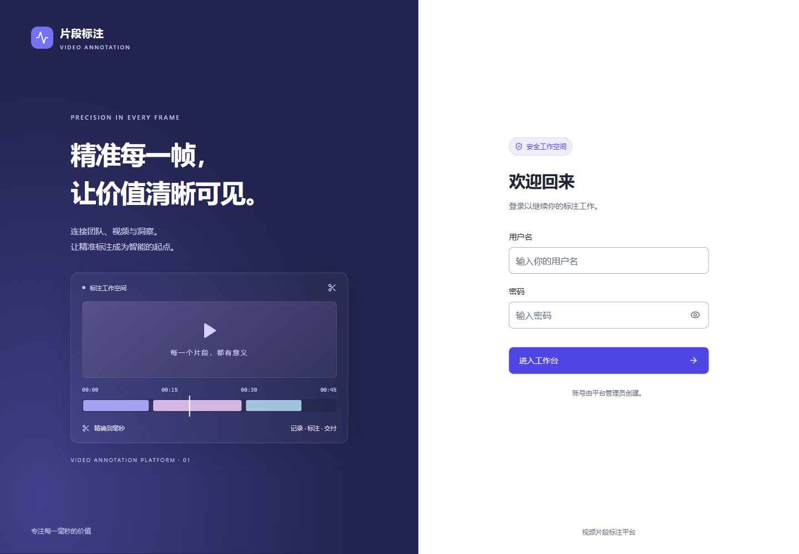
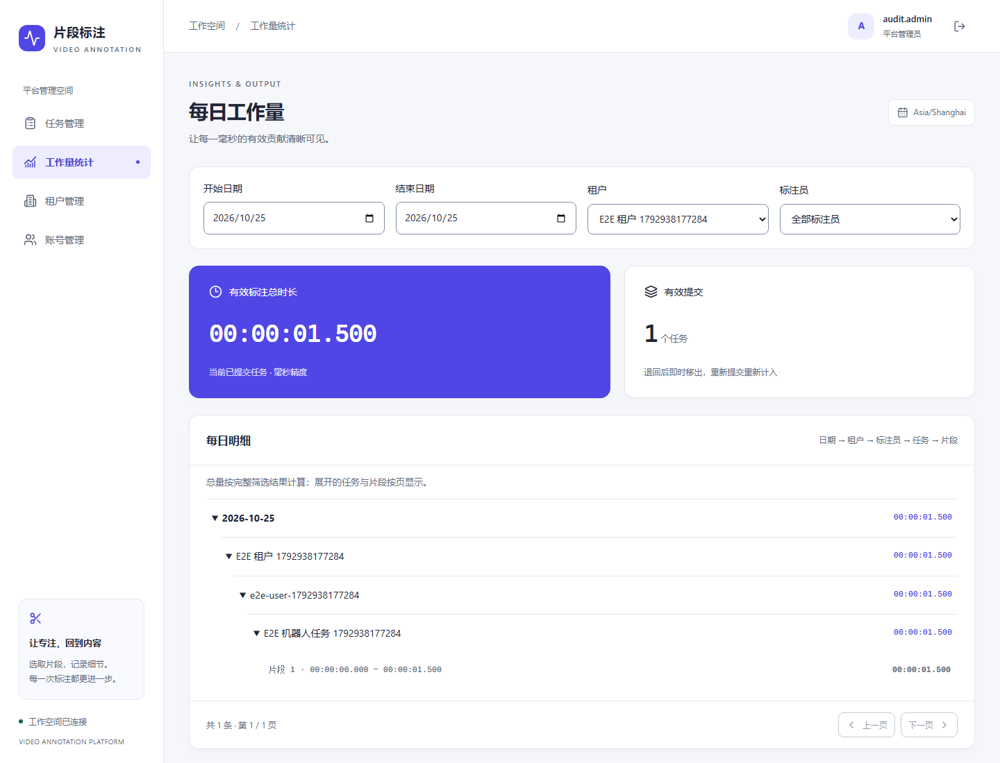

# 实现决策、AI 使用与验收报告

日期：2026-10-25。项目：视频片段标注平台。个人仓库：[HideOnBush997/video-annotation-platform](https://github.com/HideOnBush997/video-annotation-platform)。

运行环境、初始化、账号获取及测试命令见 [README](README.md)。本报告补充题目没有规定的决定、验证方法及当前限制；详细接口、状态机和数据模型见 [详细设计](doc/detailed-design.md)。

## 题目未规定的地方如何决定

| 问题 | 决定与原因 |
| --- | --- |
| 谁负责租户管理 | 平台管理员跨租户管理，标注员绑定一个租户。列表、详情和每次写操作均由后端读取真实身份与归属；跨租户资源返回404，避免仅靠前端过滤。 |
| 任务如何分配 | 任务先保存草稿，再发布领取；一个任务同时只有一个负责人。允许退回/收回，并保留片段，避免切换负责人时丢失已做工作。 |
| 提交之后如何纠错 | 已提交任务锁定；管理员退回后保留片段供修正，也可改派同租户标注员。待修正期间不计工作量，重新提交后只计入新的提交日，不重复累计。统计表示当前有效结果，不是不可变的历史工时账本。 |
| 毫秒边界如何解释 | 片段按半开区间[startMs,endMs)处理，必须非负、正长度且互不重叠；首尾相接合法。保存和提交共用服务端校验器，时长由后端按片段重新求和，不接受客户端总量。 |
| 哪一天算提交日 | 明确采用Asia/Shanghai。数据库存UTC时间，按北京时间日界线转换为UTC半开区间；片段的相对毫秒值不做时区转换。 |
| 同时领取或管理员收回怎么办 | 聚合写事务锁定任务行并检查版本；片段保存、提交和状态变更共用这套裁决。失败整体回滚，前端提示刷新，不能靠最后一次写入覆盖前一次。 |
| 视频保存在哪里 | 管理员登记HTTP/HTTPS公开视频直链，浏览器播放；平台不下载、代理或保存视频，减少大文件存储和转码范围。默认样例为机器人Push-T视频；本机联调也使用可播放的短片验证操作。 |
| 读不到视频时长怎么办 | 清楚显示加载失败/超时，提供重试和源链接。允许继续输入片段，只跳过视频边界检查，其他区间、权限和提交校验照常执行。该选择用于应对外部源不可用，限制见下文。 |
| 登录与密码规则 | 账号由管理员创建；密码至少6位，可用纯数字或字母，新账号直接进入工作台。这是后续明确确认的产品决定，取代早期设计里的首次强制改密。原数据库标记保留兼容，但不再拦截使用。 |
| 分页如何影响统计 | 汇总按全部筛选结果计算，任务和片段明细按页显示，在同一数据库快照读取，翻页不改变总量。账号/租户停用后保留关联与历史结果。 |

界面以高频标注为中心：视频、片段和时间输入放在同一工作区；可用当前位置填起止点；每次片段保存独立落库，最终提交再确认；提交后隐藏编辑控件。任务支持搜索、卡片/列表切换，窄屏上下排列，弹窗支持键盘聚焦、Tab循环和Esc退出。设计规范见 [MASTER.md](design-system/video-annotation-platform/MASTER.md)。

## 如何确认 AI 写出的代码正确

使用Codex生成和修改实现、测试及说明，但不把“代码看起来合理”或AI给出的完成描述作为验收。先把题目规则变成服务端不变量和完整操作流程，再检查真实响应、持久化结果和页面状态。

### 规则与数据库验证

- 领域测试检查负数、零长度、重复、重叠、相邻、已知/未知视频时长、空提交及Shanghai日期转换。
- 集成测试连接真实PostgreSQL，临时建库并执行迁移，验证外键、唯一约束、Seed幂等、版本冲突、并发领取及事务回滚；不以内存数据库替代事务行为。
- API测试直接请求跨租户详情、领取、片段和提交接口，证明隔离发生在后端；还覆盖停用后的已发令牌、角色、CSRF/CORS、刷新轮换和重放限制。
- 统计测试检查未提交不计、退回移除、重提换日、北京时间午夜边界及明细总量。日期边界通过控制测试数据验证，没有等待自然跨日。

主要用例见 [ApiTests.cs](backend/Feynman.Api.Tests/ApiTests.cs)、[DomainTests.cs](backend/Feynman.Api.Tests/DomainTests.cs)、[AuthDatabaseTests.cs](backend/Feynman.Auth.Tests/AuthDatabaseTests.cs) 和 [DatabaseTests.cs](backend/Feynman.Persistence.Tests/DatabaseTests.cs)。

### 页面与真实浏览器验证

组件/客户端测试检查401刷新协调、退出或换账号后的旧请求、错误提示、任务筛选、播放器状态、片段编辑和锁定。Playwright在HTTPS页面和真实API上执行管理员创建租户/账号/任务、领取、标注、提交、退回、修正、重提和统计核对；另外检查并发领取、跨租户、取消限制及即时停用。

使用Chrome DevTools MCP再次实际操作页面：读取视频元数据并播放；重叠片段和越界片段被拦截；相邻两段合计3秒，提交前统计0秒、提交后3秒；检查375px标注布局无横向溢出。MCP检查和自动化测试分开记录，不把手工检查次数计入自动测试数量。

### 已发现问题如何回归

复测发现以下3项界面问题，均先补测试复现，再修改实现：

| 问题 | 修复与回归 |
| --- | --- |
| 筛选到新租户但请求失败，仍显示旧租户时长 | 查询状态关联路径和刷新版本；加载/失败不显示旧数字，失败支持重试。测试租户/日期切换失败、重试和旧请求晚到。 |
| 创建重复用户名被误提示“状态已变化” | 按业务错误码区分重名与状态竞争，前后端给出中文重名说明；测试409响应、弹窗文案和没有多创建账号。 |
| 停用无任务租户后，账号所属租户显示“—” | 账号列表直接关联返回tenantName，显示不再依赖精简后的下拉字典；测试停用租户名称、管理员空归属及创建选项。 |

修复前新增前端回归中6项失败，新增后端2项失败；修复后全部通过。没有跳过失败测试、降低断言或关闭分析器。

## 实际执行结果

以下为2026-10-25最新代码复测结果，后端和业务E2E使用隔离数据库，测试结束清理临时服务与数据。

| 检查 | 结果 |
| --- | --- |
| .NET / 真实PostgreSQL测试 | 70通过：API/Domain 46、Auth 13、Persistence 11；0失败、0跳过 |
| Vitest组件与API客户端测试 | 48通过，0失败 |
| HTTPS Playwright E2E | 5通过，0跳过 |
| TypeScript / Vite生产构建 | 通过 |
| Prettier、dotnet format、Git空白检查 | 通过 |
| 修复后Chrome DevTools MCP复查 | 断网切换筛选、恢复重试、租户名称、重名提示4项检查通过 |

可复跑命令：

```powershell
dotnet test Feynman.slnx --artifacts-path D:\Codex\Work\feynman-build
dotnet format Feynman.slnx --verify-no-changes
cd frontend
npm test
npm run build
npm run format:check
# 按README启动服务、配置E2E管理员凭据后
npm run e2e
```

Windows运行中的API可能锁定默认输出目录的exe，因此测试可使用独立artifacts路径。后端测试需要可创建临时库的PostgreSQL连接。E2E会创建测试租户、账号和任务，应使用独立测试环境；测试凭据从环境变量或被忽略的本地文件读取。合成测试口令不代表部署凭据。

以下截图来自实际浏览器，统计页使用合成E2E数据：





## 使用的 rules 和 skills

- **用户当前指令与AGENTS.md**：先读Obsidian记忆索引及最小相关笔记，记忆仅作上下文，当前指令优先；生成物放D盘；秘密不进入记忆或仓库。私人记忆、真实运行配置和数据库不随源码提交。
- **项目规则**：[需求](doc/proposal.md)、[概要设计](doc/high-level-design.md)、[详细设计](doc/detailed-design.md)、[模块验收清单](doc/tasks/progress.md) 及 [开发Prompt](doc/prompt.md)。重点是后端隔离、事务/版本裁决、统一校验、真实数据库测试和按实际执行更新进度；后续确认的账号规则以当前README与本报告为准。
- **ui-ux-pro-max**：界面迭代使用本机安装的该skill检索设计方向，并按标注工作台场景适配；选择与参考记录在设计规范中。参考shadcn/ui的工作台组织和Label Studio的标注流程，没有引入其源码或组件依赖。
- **chrome-devtools**：使用Chrome DevTools MCP随包skill的导航→快照→按UID交互流程，配合网络模拟、控制台和截图复查。工具来源：[ChromeDevTools/chrome-devtools-mcp](https://github.com/ChromeDevTools/chrome-devtools-mcp)。

Skills和MCP是开发/验收工具，不是运行应用的必要依赖。

## 尚未实现及仍需注意的地方

1. **外部视频与可信时长**：可播放性依赖源站、网络和浏览器。视频时长来自浏览器，后端不独立解析媒体；未知时允许跳过边界检查，因此不能把这一机制视为防作弊或真实视频范围的独立证明。若需要严格质检，应增加可信媒体元数据、审核及异常检测。
2. **历史口径**：目前只保存当前片段与当前有效提交，不保存片段版本和不可变的历史统计快照。退回/重提会改变此前日期的当前统计，这是已确认口径；需要结算留痕时应增加审计日志和版本化结果。
3. **部署与规模**：交付为本地开发应用，没有生产部署、视频上传/转码/代理或统计预聚合；未做生产规模压力测试。生产域名、证书、密钥、Cookie/CORS及数据库备份恢复需要按部署环境验证。大日期范围统计目前会加载符合条件的汇总记录，数据增长后需评估查询与内存成本。

本次发现的3项Bug已修复。上述限制为明确范围或未验证的生产能力，不作为自动测试已覆盖的内容。
